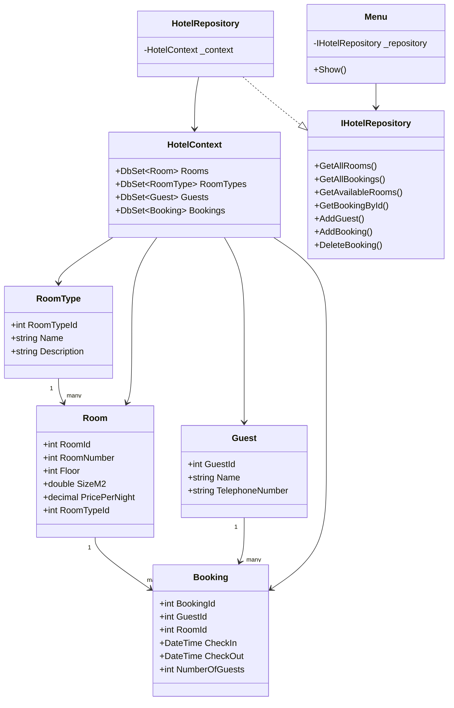

# Hotel Grandioso — Inlämning 1

**Namn:** Luvinda Sanchana Weerasinghe

## Så kör du projektet

1. Gå till projektets GitHub-repository: [Hotel Grandioso](https://github.com/Luvinda-Sanchana/clo26-hotel-grandioso).
2. Klicka på den gröna knappen **Code** och välj **Download ZIP**.
3. När ZIP-filen har laddats ner, högerklicka på filen och välj **Extract All**.
4. Öppna den uppackade projektmappen.
5. Öppna filen `HotelGrandioso.sln` i Visual Studio.
6. Vänta tills Visual Studio har laddat projektet och återställt NuGet-paketen.
7. I Solution Explorer, högerklicka på projektet **HotelGrandioso** och välj **Set as Startup Project** om det inte redan är valt.
8. Klicka på den gröna **Start**-knappen eller tryck på **F5** för att köra applikationen.

**Obs:** Projektet använder SQLite och Entity Framework Core. Databasfilen ingår inte i GitHub-repositoryt. Den skapas automatiskt när applikationen startas för första gången, med hjälp av projektets Entity Framework Core-migrationer.

## Databas

- Databas: SQLite (Skapa och starta automatiskt)
- Migrationer: Entity Framework Core 10. Databasen skapas och uppdateras med Entity Framework Core migrations.

## UML-klassdiagram

## GDPR

Utvärdera fälten i `Guest` ett i taget. Vad bygger du in, och varför?

Jag har inkluderat tre fält i klassen Guest:

- GuestId: Används för att ge varje gäst ett unikt ID.
- Name: Krävs för att identifiera gästen och koppla denne till sin bokning.
- TelephoneNumber: Krävs för att hotellet ska kunna kontakta gästen.

Jag har endast samlat in den information som behövs för att hantera bokningarna och undvikit att ta in onödiga uppgifter.

## Designmönster

Jag har använt mönstret Repository i det här projektet.

Detta beror på att mönstret separerar databasoperationer från resten av applikationen.

Jag har använt ett interface som heter `IHotelRepository` samt en klass vid namn `HotelRepository`. Repository-komponenten hanterar uppgifter som att lägga till bokningar, ta bort bokningar och söka efter tillgängliga rum.

Jag valde detta mönster eftersom det gör koden enklare att organisera och förstå, samt gör det lättare att genomföra nödvändiga ändringar.

## Tekniker

- C# / .NET 10
- Entity Framework Core 10
- SQLite
- Code First migrations
- LINQ for database queries
- OOP
- Repository Pattern
