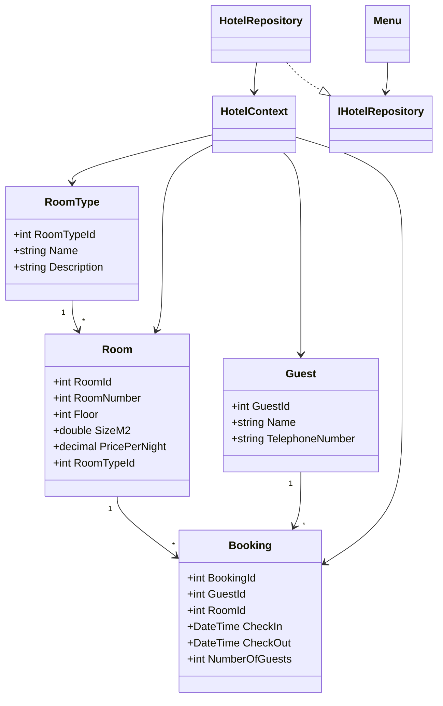

# Hotel Grandioso — Inlämning 1

**Namn:** Luvinda Sanchana Weerasinghe

## Så kör du projektet

1. Öppna projektmappen `HotelGrandioso`.
2. Öppna terminalen i projektmappen.
3. Installera projektets dependencies:

```powershell
dotnet restore
```

4. Skapa eller uppdatera databasen:

```powershell
dotnet ef database update
```

5. Starta applikationen:

```powershell
dotnet run
```

**Obs:** En lokal `appsettings.json` med rätt SQLite connection string behövs för att köra projektet.

## Databas

- Databas: SQLite
- Migrationer: Entity Framework Core 10. Databasen skapas och uppdateras med Entity Framework Core migrations


## UML-klassdiagram



## GDPR

Utvärdera fälten i `Guest` ett i taget. Vad bygger du in, och varför?

Jag har inkluderat tre fält i klassen Guest:

- GuestId: Används för att ge varje gäst ett unikt ID.
- Name: Krävs för att identifiera gästen och koppla denne till sin bokning.
- TelephoneNumber: Krävs för att hotellet ska kunna kontakta gästen.

Jag har endast samlat in den information som behövs för att hantera bokningarna, och undvikit att ta in onödiga uppgifter såsom hårfärg, religion, etc.

>

## Designmönster

Beskriv det designmönster du använt (till exempel Repository), vad det gör och varför du valde det.

Jag har använt mönstret Repository i det här projektet.

Detta beror på att mönstret separerar databas operationer från resten av applikationen.

Jag har använt an interface som heter IHotelRepository samt a class vid namn HotelRepository. Repository komponenten hanterar uppgifter som att lägga till bokningar, ta bort bokningar och söka efter tillgängliga rum.

Jag valde detta mönster eftersom det gör koden enklare att organisera och förstå, underlättar sökandet efter klasser och gör det lättare att genomföra nödvändiga justeringar.

>

## Tekniker

- C# / .NET 10
- Entity Framework Core 10
- SQLite database
- Code First migrations
- LINQ for database queries
- OOP
- Repository Pattern
